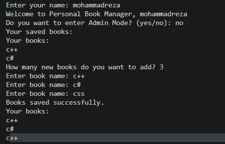

# 📚 Personal Book Manager

A simple personal book management application built with **Python**. It allows users to add multiple books, view their book collection, and save book information so it remains available even after closing the program.

## ✨ Features

- Add multiple books
- Display all books
- Save book information in a JSON file
- Load previously saved books
- Handle missing JSON files
- Admin Mode with password protection
- Secure password configuration using environment variables

## 🛠️ Requirements

- Python 3
- python-dotenv

## 📁 Project Structure

```text
## Project Structure

```text
personal_book_manager/
│
├── main.py              
├── books.py             
├── .gitignore           
├── .env.example        
├── requirements.txt     
└── images/              
```
```

## 🚀 Installation

### 1. Clone the Repository

```bash
git clone https://github.com/YOUR-USERNAME/personal_book_manager.git
```

### 2. Navigate to the Project Directory

```bash
cd personal_book_manager
```

### 3. Install Dependencies

```bash
pip install -r requirements.txt
```

## 🔐 Environment Setup

Create a file named `.env` in the main project directory.

The `.env.example` file is provided as a template to show which environment variables are required.

The project requires the following environment variable:

```env
BOOK_MANAGER_ADMIN_PASSWORD
```

Add this variable to your `.env` file:

```env
BOOK_MANAGER_ADMIN_PASSWORD=your_password_here
```

Replace `your_password_here` with your own password.

**Important Security Notes:**

- Never upload your `.env` file to GitHub.
- Keep your actual password private.
- Include the `.env.example` file in your repository.
- Keep the actual `.env` file local.

## How It Works

1. The program starts by running main.py.
2. It asks the user to enter their name.
3. It loads previously saved books.
4. The user enters how many new books they want to add.
5. The program asks for the information of each book.
6. The user can view their saved books.
7. The book information is saved in books.json.
8. Admin Mode allows the administrator to access the protected section using a password from the .env file.

## ▶️ Run the Program

The main application file is `main.py`.

Run the application using:

```bash
python main.py
```

## Troubleshooting

### 1. FileNotFoundError

- **Meaning:** Python cannot find a required file.
- **Cause:** The file may be missing or the program may be running from the wrong folder.
- **First check:** Check whether the required files exist in the project folder.

### 2. JSONDecodeError

- **Meaning:** Python cannot read the JSON file.
- **Cause:** `books.json` may be empty or contain invalid JSON.
- **First check:** Check the contents of `books.json`.

### 3. ModuleNotFoundError

- **Meaning:** Python cannot find an imported module.
- **Cause:** The `python-dotenv` package may not be installed.
- **First check:** Check `requirements.txt` and install the packages:

```bash
pip install -r requirements.txt
```

### 4. Password Not Found

- **Meaning:** The program cannot read the admin password.
- **Cause:** The `.env` file may be missing or the variable name may be incorrect.
- **First check:** Check that `.env` exists and contains `BOOK_MANAGER_ADMIN_PASSWORD`.

## 📸 Screenshot



## 📦 Gifs


## 💻 Technologies Used

- Python
- JSON
- python-dotenv
- Git
- GitHub

## 👨‍💻 Author

**Mohammad Reza Emran**
